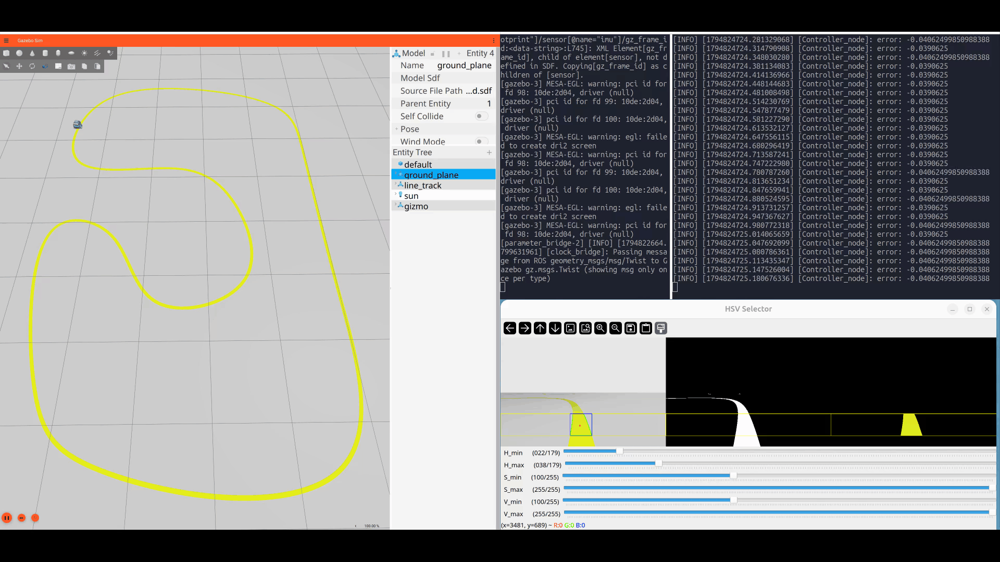

# Gizmo AMR Simulation: Visual Servoing Line Follower

A reproducible autonomous robotics workspace for the Gizmo 2-Wheel Differential Drive Autonomous Mobile Robot (AMR). Built on ROS 2 Jazzy, Gazebo Harmonic, and OpenCV, isolated with the Pixi package management ecosystem.

---

## Getting Started

### Prerequisites

All dependencies (ROS 2 lyrical, Gazebo Harmonic, OpenCV) are managed reproducibly via [Pixi](https://pixi.sh).

```bash
# Clone the repository
git clone https://github.com/CoreBotics-Lab/gizmo_amr_simulation.git
cd gizmo_amr_simulation

# Enter the isolated Pixi environment
pixi shell
```

### Build the Workspace

```bash
# Build the ROS 2 packages with symlink install
colcon build --symlink-install

# Source the workspace setup file
source install/setup.bash
```

---

## Running the Line Follower

Open two terminals inside the repository and run:

### Terminal 1: Launch Gazebo Simulation
```bash
pixi shell
ros2 launch gizmo_gazebo gazebo_lineWorld.launch.py
```

### Terminal 2: Run Autonomous Line Follower
```bash
pixi shell
ros2 run gizmo_scripts line_follower
```
* Automatically streams the monocular camera feed, extracts the track centroid, and executes the PD steering controller with adaptive throttle.
* Press `Ctrl+C` at any time to cleanly halt the robot and shut down nodes.

---

## System Architecture

The line-following system implements a closed-loop Visual Servoing architecture partitioned into Perception and Control nodes managed by a `SingleThreadedExecutor`:

```
+-----------------------------------------------------------------------------------+
|                               Perception Pipeline                                 |
|                                                                                   |
|  /camera/image_raw (BGR)                                                          |
|           │                                                                       |
|           ▼                                                                       |
|   ROI Slicing [70% - 90% Height]                                                  |
|           │                                                                       |
|           ▼                                                                       |
|   HSV Segmentation (H: 22..38, S: 100..255, V: 100..255)                          |
|           │                                                                       |
|           ▼                                                                       |
|   Contour Extraction & Single Largest Target Filter                               |
|           │                                                                       |
|           ▼                                                                       |
|   Centroid Calculation & Normalization: e = (cx - center_x) / (width / 2.0)       |
+-----------------------------------------------------------------------------------+
                                    │
                                    │ /centroid_error (Float32, e in [-1.0, 1.0])
                                    ▼
+-----------------------------------------------------------------------------------+
|                                Control Pipeline                                   |
|                                                                                   |
|   Discrete Proportional-Derivative (PD) Steering:                                 |
|     ω_z = -(Kp * e + Kd * (Δe / Δt))                                              |
|     (Kp = 4.0, Kd = 0.30)                                                         |
|                                                                                   |
|   Dual-Mode Adaptive Throttle with Hysteresis:                                    |
|     |e| < 0.03  ==>  v_x = 0.50 m/s (Straightaway Sprint)                         |
|     |e| > 0.06  ==>  v_x = 0.30 m/s (Cornering Deceleration)                      |
|                                                                                   |
|   Emergency Track-Loss Guard:                                                     |
|     e is NaN    ==>  Immediate 5-packet halt burst, reset dt, latch teleop        |
+-----------------------------------------------------------------------------------+
                                    │
                                    │ /cmd_vel (geometry_msgs/Twist)
                                    ▼
+-----------------------------------------------------------------------------------+
|                        Gazebo Harmonic (diff_drive plugin)                        |
|                                                                                   |
|   Applies wheel angular velocities: v_left, v_right                               |
+-----------------------------------------------------------------------------------+
```

---

## Demonstration


